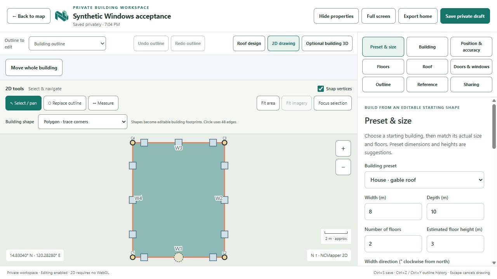

# NCMapper Community · Windows pilot

A Windows client for the NCMapper community mapping workflow: editable building presets, occupied-space and floor records, private drafts and independent map review.

**[Download the Windows pilot](https://github.com/norielcalingasan/NCMapper-Releases/releases/tag/v0.1.0-pilot.1)**

This repository contains public client downloads, checksums and documentation. The application source repository remains separate. The client connects to a community server selected by its user; this release does not provide a public mapping server or include a city database.

## What the pilot supports

- Resize and rotate flat, gable, hip, single-slope and roof-deck starting buildings.
- Record the occupied ground footprint, individual floor outlines and floor counts.
- Generate suggested windows and a front door, then adjust and confirm actual openings. Fire exits are recorded explicitly.
- Keep device fixes and alignment references private; share only selected observed fields through independent review.
- Start with 2D drawing and open the selected building's optional 3D preview.



## Start

1. Download `NCMapper-Community-0.1.0-x64.exe` and `SHA256SUMS.txt` from the release.
2. Verify the EXE's SHA256 against the checksum file. The pilot is **unsigned**.
3. Open the EXE and enter the HTTPS community-server address provided by your coordinator. Credentials belong to that server; a temporary demonstration account will not sign into another server.
4. Use your invitation/account and [contributor guide](USER_GUIDE.md). Contributions stay private until selected fields receive independent approval.

```powershell
Get-FileHash -LiteralPath '.\NCMapper-Community-0.1.0-x64.exe' -Algorithm SHA256
```

Windows 11 x64 is the current support target. Physical minimum-device certification remains pending. View → Actual Size (Ctrl+0) restores normal scale; View → 200% zoom provides an enlarged view.

## Accuracy and pilot limits

Measured building corners, floor counts and opening locations need reliable references and field checks. A preset, GPS fix or review approval does not establish surveyed precision or certify a fire-escape route. The pilot does not assess route capacity/condition, legal access or structural design.

See [verification and remaining acceptance](VERIFICATION.md) and the [current validation status](STATUS.md). There is no offline synchronization, public hosted community service, signed installer or automatic updater in this pilot.

## Privacy and reports

No resident database, house photograph, device fix or service credential is bundled. The selected community server stores submitted information under its own operating/privacy rules. Use a coordinator-approved server and obtain permission for the information you contribute. Reference-map providers may receive ordinary map requests.

Report ordinary reproducible software problems in this repository's issues using synthetic examples. Keep passwords, private coordinates, home photos and invitation codes out of public issues. Use [private security reporting](SECURITY.md) for vulnerabilities.

NCMapper's own software uses the [MIT license](LICENSE). Runtime dependencies and geographic data retain their [separate notices and licenses](THIRD_PARTY_NOTICES.md).
